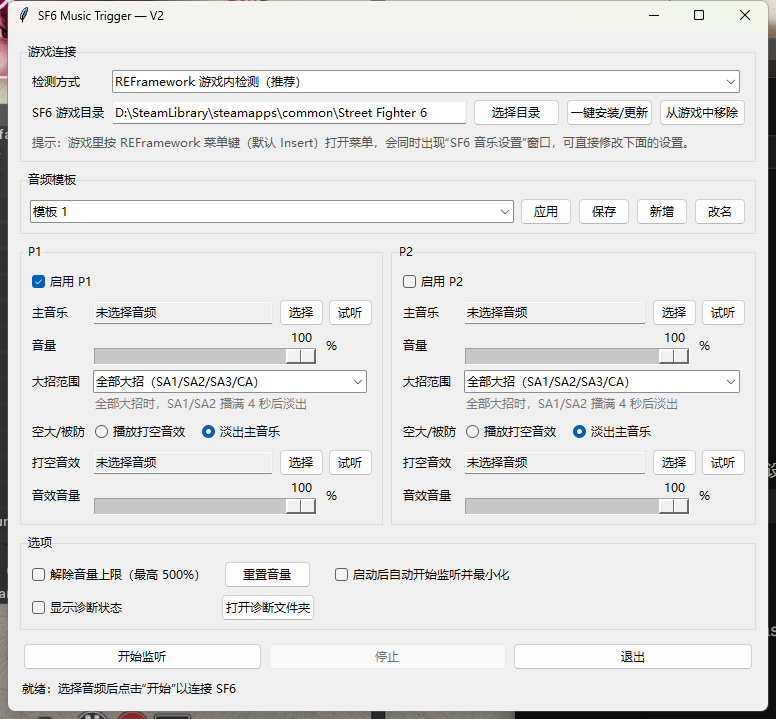
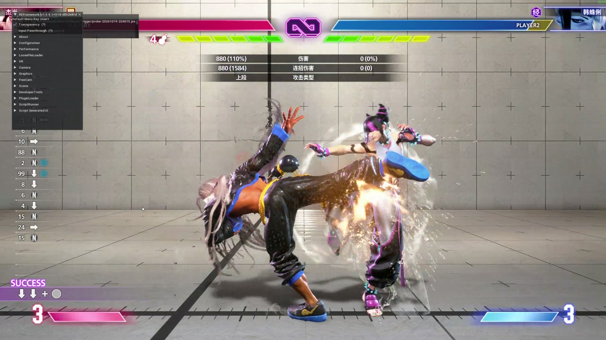

# SF6 Music Trigger V2

**中文** | [English](#english)

在《街头霸王 6》里放出超必杀（SA1 / SA2 / SA3 / CA）时，自动播放你自己选的音乐；被防或空大时，可以改放打空音效，或者淡出主音乐。

V2 通过 REFramework 在游戏内直接读取超必杀事件，不再识别画面，所以换 UI、换分辨率、全屏都不受影响，全角色通用。





## 功能

- **全角色识别**：从游戏数据里读取每个角色的超必杀表，DLC 角色也能识别。已实测：杰米、不知火舞、桑吉尔夫。
- **命中 / 被防 / 空大**：
  - 被防：对手一防住就立即判定。
  - 空大：在攻击判定帧结束后立即判定，约 2 秒内。
  - 连段断掉后接的超必杀，按实际结果判定，不会误当成命中。
- **游戏内设置**：打开 REFramework 菜单（默认 Insert 键）时，会同时出现中文的"SF6 音乐设置"窗口，可以改音乐、音量、大招范围、打空处理，也可以开始或停止监听，不用切出全屏游戏。
- **音量**：最高可调到 500%，超过 100% 的部分带防爆音限幅；可以一键重置音量。
- **一键安装 / 一键移除**：发布包附带 REFramework。移除后游戏目录可以恢复原样；如果有其他 REFramework Mod，会自动保留 REFramework。
- **只用于离线**：训练模式、CPU 对战、本地对战。检测到联机对战时自动停用。
- **只读**：不改动游戏文件，不发送按键输入，不上传任何数据。

## 下载与安装

1. 在 [Releases](../../releases) 下载 `SF6_Music_Trigger_V2_<版本>.zip`。
2. **完整解压**到任意文件夹，不要直接在压缩包里运行。
3. 把音乐（wav / ogg / mp3）放进 `music` 文件夹。
4. 关闭游戏，打开 `SF6 Music Trigger.exe`。Windows 弹出提示时，点"更多信息"，再点"仍要运行"。
5. 点 **一键安装/更新**。
6. 为 P1 / P2 选择音乐，点 **开始监听**，然后启动游戏。
7. 建议勾选 **启动后自动开始监听并最小化**。

详细教程见 [docs/v2/user-guide.md](docs/v2/user-guide.md)。

## 卸载

关闭游戏，在面板里点 **从游戏中移除**，再删除程序文件夹即可。

## 反馈

请附上：使用的角色、出了什么问题、大概的时间，以及游戏目录下 `reframework\data\SF6MusicTrigger\events.jsonl`（面板里的"打开诊断文件夹"可以直接打开）。日志里只有角色编号和动作编号。

---

<a id="english"></a>

## English

Plays your own music when a Street Fighter 6 super art (SA1/SA2/SA3/CA) is used, and a whiff sound or a fade when it is blocked or whiffs. V2 reads the super events inside the game through a REFramework Lua script, so it no longer depends on HUD pixels: other UI layouts, resolutions and fullscreen all work, for every character.

### Features

- **Every character**: each character's super table is read from game data, DLC included. Live-tested with Jamie, Mai and Zangief.
- **Hit / block / whiff**:
  - A block is decided when the opponent starts guarding.
  - A whiff is decided right after the super's attack frames end (within about 2 s).
  - Supers after a dropped combo are judged by what actually happens to them.
- **In-game settings window**: it opens together with the REFramework menu (Insert by default). Change tracks, volumes, scope and whiff handling, or start and stop listening, without leaving a fullscreen game.
- **Volume up to 500%** with a soft limiter, plus a reset button.
- **One-click install and removal**: REFramework is bundled. Removal restores the game folder, and keeps REFramework when other REFramework mods are present.
- **Offline only** (training, versus CPU, local versus). Detection switches off automatically during online matches.
- **Read-only**: no game files are modified, no input is sent, and nothing is uploaded. See [PRIVACY.md](PRIVACY.md).

Users choose their own music; the project does not bundle commercial songs. This is an unofficial community project, not affiliated with or endorsed by Capcom.

### Install

1. Download `SF6_Music_Trigger_V2_<version>.zip` from [Releases](../../releases) and extract it fully.
2. Put your music (wav/ogg/mp3) into `music`.
3. Close the game, run `SF6 Music Trigger.exe`, and click **一键安装/更新** (one-click install).
4. Pick tracks for P1/P2, click **开始监听** (start listening), then start the game.

To uninstall, close the game, click **从游戏中移除** (remove from game), and delete the program folder.

### Development

```powershell
python -m venv .venv
.\.venv\Scripts\python -m pip install -e ".[dev]"
.\.venv\Scripts\python -m pytest
.\run_v2.bat
```

| Part | Where |
| --- | --- |
| In-game detector (Lua) | `src/sf6_music_trigger/game_scripts/sf6_music_trigger.lua` |
| In-game settings window (Lua) | `src/sf6_music_trigger/game_scripts/sf6_music_trigger_ui.lua` |
| Event reader / audio policy | `reframework_events.py`, `ref_engine.py` |
| Settings bridge / installer | `game_ui.py`, `game_install.py` |
| Panel (Tk) | `panel.py` |

The Lua scripts are tested offline with a fake REFramework runtime (embedded Lua 5.4 via lupa), including real action timelines recorded in the game. The design notes and event protocol are in [docs/v2/design-notes.md](docs/v2/design-notes.md).

The installer and release builds look for REFramework in `third_party/REFramework/` (`dinput8.dll`, `LICENSE.txt`, `revision.txt`, from https://github.com/praydog/REFramework-nightly/releases). That folder is not committed. Release builds are made with `tools/portable_release.py --reframework-dir third_party/REFramework ...`.

### Credits

- [REFramework](https://github.com/praydog/REFramework) by praydog (MIT), bundled in releases.
- [MMDK](https://github.com/alphazolam/MMDK) by alphaZomega, used as a reference for SF6 battle data structures.
